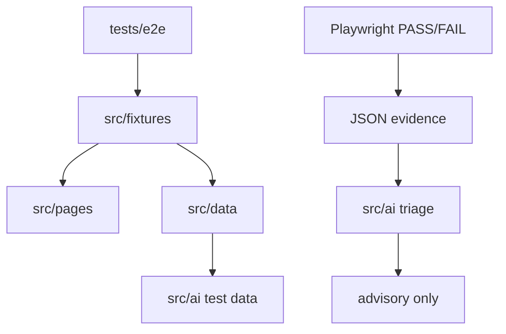

# Playwright Quality Framework

Policy-Driven Test Automation with Deterministic Quality Gates and Bounded AI Assistance.

## Fast Workflow

```text
Record -> Agent -> Validate -> Demo
```

```powershell
npm run record -- <URL>
npm run validate
npm run test:ui
npm run report
```

Codegen captures the interaction. The coding agent implements it according to `AGENTS.md`. Playwright remains the deterministic test oracle.

See `docs/QUICKSTART.md` for the operator workflow.



Playwright assertions are the test oracle. AI can provide schema-validated data and advisory triage, but cannot decide pass or fail.

## Directories

- `tests/e2e`: deterministic scenarios and assertions.
- `src/fixtures`: approved test entry point and dependency injection.
- `src/pages`: thin Page Objects and locators.
- `src/data`: reusable non-sensitive test input and data factories.
- `src/ai`: bounded AI data and triage modules.
- `scripts`: policy, secret, and triage commands.

## Setup

```powershell
npm ci
npx playwright install chromium
```

Optional `.env` values are shown in `.env.example`. Do not commit `.env` or storage state files.

`BASE_URL` must point to the actual application under test before application E2E specs are added.

## Commands

- `npm run lint`
- `npm run policy:check`
- `npm run secret:check`
- `npm run test:e2e`
- `npm run test:ui`
- `npm run test:headed`
- `npm run test:debug`
- `npm run record -- <URL>`
- `npm run report`
- `npm run policy:selftest`
- `npm run triage:selftest`
- `npm run validate`

## Policy As Code

ESLint Flat Config and scripts reject direct `@playwright/test` imports from E2E tests, raw locators in tests, `waitForTimeout`, swallowed assertions, focused/skipped tests, force clicks, inline ESLint disables, Page Object assertions, and AI module assertions.

## AI Boundary

AI data must be JSON and pass caller-supplied Zod validation. Invalid or unavailable AI output uses the caller-supplied deterministic fallback. AI triage consumes failure evidence after Playwright runs and returns an advisory classification. `INCONCLUSIVE` is a triage classification, not a Playwright status.

## Self-Tests

`npm run policy:selftest` creates temporary invalid fixtures and proves policy violations are rejected. `npm run triage:selftest` prints a failed Playwright status with advisory triage and does not alter the status.

## Known Limitations

Static checks do not prove arbitrary semantic assertion equivalence, such as changing an exact expected value to a weaker partial value. That remains a governed human review boundary.

## Production Backlog

Consider Dependency-Cruiser, semantic diffing, richer evidence reports, worker account strategy, API cleanup helpers, sharding, and broader browser coverage only when project scale justifies them.
