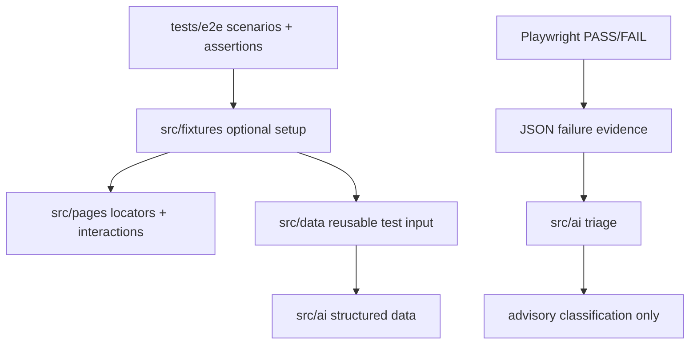

# Policy-Driven Playwright AI Automation Template

Reusable JavaScript Playwright template for human QA engineers and AI coding agents.

## Fast Workflow

```text
Record -> Agent -> Test -> Triage on failure -> Retest -> Validate
```

```powershell
npm run record -- <URL>
npm run test:e2e
npm run triage
npm run validate
```

Codegen captures interaction only. The coding agent implements the recorded flow according to `AGENTS.md`. Playwright remains the deterministic PASS/FAIL oracle; AI is bounded to structured data and advisory failure triage.

See `docs/QUICKSTART.md` for the operator workflow.



## Directories

- `tests/e2e`: behavior scenarios and deterministic assertions.
- `src/fixtures`: approved test entry point, lifecycle, preconditions, and dependency injection when justified.
- `src/pages`: thin Page Objects that own locators and page interactions.
- `src/data`: reusable non-sensitive test input and data factories independent of UI implementation.
- `src/ai`: bounded AI structured-data and advisory-triage modules.
- `scripts`: policy, secret, validation, evidence extraction, and triage commands.
- `policies`: architecture contract used by agents and human review.

## Setup

```powershell
npm ci
npx playwright install chromium
```

Application runtime configuration is separated from AI provider configuration:

```text
.env
  BASE_URL=...

.env.ai
  AI_API_KEY=...
  AI_BASE_URL=...
  AI_MODEL=...
```

Use `.env.example` and `.env.ai.example` as safe templates. `.env` and `.env.ai` are ignored and must not be committed.

`BASE_URL` must point to the application under test. Page Objects should use relative application routes when Playwright `baseURL` is configured.

## Commands

- `npm run lint`
- `npm run policy:check`
- `npm run contract:ai`
- `npm run secret:check`
- `npm run test:e2e`
- `npm run test:ui`
- `npm run test:headed`
- `npm run test:debug`
- `npm run record -- <URL>`
- `npm run report`
- `npm run triage`
- `npm run policy:selftest`
- `npm run triage:selftest`
- `npm run validate`

`npm run validate` is the deterministic local quality gate: lint + policy checks + tracked-secret/runtime-artifact scanning + configured E2E execution. It does not require the AI provider.

`npm run triage` reads the latest real Playwright JSON failure evidence and asks the configured AI provider for a schema-validated advisory classification. `npm run triage:selftest` uses synthetic failure evidence to test the triage engine itself; it does not represent the status of the current application test suite.

## Policy As Code

ESLint Flat Config and repository scripts reject common syntactic weakening such as direct `@playwright/test` imports from E2E tests, raw locators in tests, `waitForTimeout`, swallowed assertions, focused/skipped tests, force clicks, inline ESLint disables, Page Object assertions, and AI module assertions.

Architecture ownership that requires semantic understanding remains governed by `AGENTS.md` and human review. Modular does not mean every test must create a Page Object, data module, and fixture; only layers with a real responsibility should be used.

## AI Boundary

AI output is schema validated. AI triage may classify real Playwright failure evidence as `PRODUCT_BUG`, `AUTOMATION_DEFECT`, `ENVIRONMENT_FAILURE`, `TEST_DATA_FAILURE`, `FLAKY`, or `INCONCLUSIVE`.

AI must not change selectors at runtime, heal tests, alter expected values, skip tests, or modify Playwright status. A failed Playwright result remains failed until the automation or product is genuinely corrected and retested.

## Self-Tests

`npm run policy:selftest` creates temporary invalid fixtures and proves policy violations are rejected.

`npm run triage:selftest` creates synthetic failure evidence and verifies the live/fallback triage path without changing any application test result.

## Known Limitations

Static checks cannot prove arbitrary semantic correctness, such as whether a literal should be reusable data, whether a fixture is justified, or whether an expected business value was weakened. Those remain governed agent/human review boundaries.

## Production Backlog

Consider semantic diffing, richer evidence reports, worker account strategy, API cleanup helpers, sharding, broader browser coverage, and other architecture additions only when project scale justifies them.
